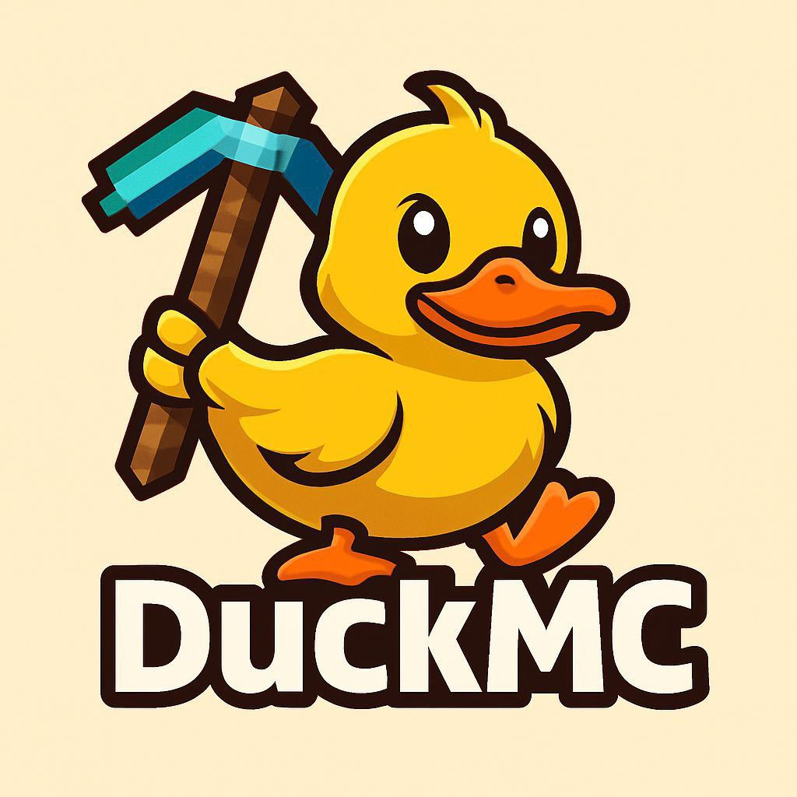

# 🦆 DuckMC — кроссплатформенный Minecraft лаунчер

Лаунчер **Java Edition + Bedrock Edition** для **Windows, Android, iOS, Linux и macOS**.
**Приоритетная платформа — Android.**



## Что уже работает (версия 0.1.0 «Quack»)

| Раздел | Статус |
|---|---|
| 🏠 Главная: выбор издания (Java/Bedrock), версии, кнопка ИГРАТЬ с прогрессом | ✅ работает (демо-конвейер) |
| ⬇️ Скачивание: живой список версий Java из манифеста Mojang + офлайн-кэш, фильтры, поиск | ✅ работает |
| 👤 Аккаунты: Microsoft (device code), ely.by и совместимые authserver'ы, оффлайн-ник | ✅ UI + реальная логика (в браузере часть запросов режет CORS — на нативе будет без ограничений) |
| ⚙️ Настройки: память, Java, разрешение, тема, язык (RU/EN), авторизация, загрузки | ✅ работает, сохраняется на устройстве |
| 📱 Установка на телефон «здесь и сейчас» | ✅ PWA: открыть сайт → «Добавить на главный экран» |

## Быстрый старт

```bash
cd app
npm install
npm run dev        # http://localhost:5173
npm run build      # прод-сборка в app/dist
```

## Структура

```
app/                 приложение (React + TypeScript + Vite)
  src/core/          «мозги»: config, auth, versions, launch, platform
  src/views/         экраны: Главная, Скачивание, Аккаунты, Настройки
docs/
  ROADMAP.md         ⭐ варианты развития и план по платформам — начните с него
  auth.md            авторизация: Microsoft, ely.by/eby.by, оффлайн
  bedrock.md         как легально работать с Bedrock Edition
```

## Про «eby.by» и «ely.by»

В настройках авторизации адрес auth-сервера **свободно меняется**. По умолчанию стоит
`https://authserver.ely.by` (самый известный сервис такой схемы). Если имелся в виду
другой сервер (например `eby.by`) — просто впишите его адрес в **Настройки → Авторизация**,
DuckMC совместим с любым провайдером протокола authserver. Подробнее: `docs/auth.md`.

## Лицензия

MIT. Логотип: `IMG_20261031_130628_458.jpg`.
